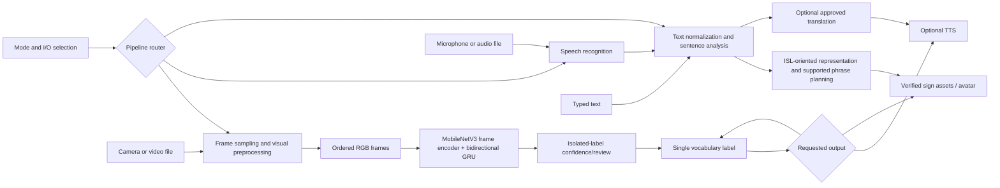

# Architecture

Status: local prototype implemented for isolated video-to-label, label-to-speech, and exact recorded sign-label lookup. Continuous, language-level, and avatar paths remain future architecture.

## System overview

Select a pipeline from input and output modes. Keep visual recognition, speech recognition, text processing, translation, TTS, and sign realization independent behind small interfaces. Unsupported routes must return a user-visible unsupported-mode result.

## Module responsibilities

- **UI/router:** validates the selected input/output pair and dispatches to a matching pipeline.
- **Vision/data:** samples frames at a documented target rate, preserves timestamps/order, and emits a fixed-shape or variable-length sequence with explicit missing-feature values.
- **Recognition:** model interface accepts a clip/sequence and returns ranked labels, scores, and timing where supported. Unknown/low-confidence output is a first-class result.
- **Sequence decoding:** temporal smoothing and utterance boundaries for streaming; CTC only for continuous gloss sequences with aligned sequence labels, not isolated clip classification.
- **Text processing/sign generation:** documented intermediate representation and reviewed phrase/asset coverage. Vocabulary lookup is not general English-to-ISL translation.
- **Speech/translation/output:** independent ASR, translation and TTS adapters; language and privacy limits are explicit.

## Data flow and error handling

Video flows through ordered timestamps, preprocessing, feature extraction, recognition, optional sequence decoding, then user-reviewed text/speech. Audio flows through ASR before text processing. Typed text bypasses ASR. Text/audio-to-sign uses the same constrained sentence-analysis and sign-planning interface. Missing camera/microphone, unreadable media, missing model/assets, low confidence, and unsupported routes produce actionable errors; they must not silently return a different modality.

Raw participant media stays outside ordinary Git history. Logging records technical status/timings, not private media or transcripts by default.

## Model interfaces

The implemented baseline is an isolated-sign clip classifier: MobileNetV3-Small extracts per-frame RGB features, then a bidirectional GRU models frame order. It samples a fixed 12-frame clip. The local archive lacks signer IDs, so the generated manifest uses clip-level splits and cannot substantiate signer-independent performance. Continuous decoding, landmarks, grammatical text processing, ASR, translation, and avatar generation remain future work. The selected candidates and evidence limits are in `MODEL_SELECTION.md`.
