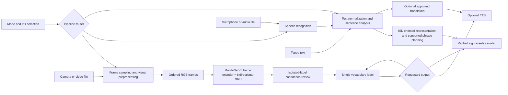

# Architecture

Status: local prototype implements rolling live-camera windows to isolated labels, label-to-speech, video upload, exact recorded sign-label lookup, and online English-to-Indian-language text translation (Kannada, Hindi, Tamil, Telugu, Malayalam). Translation sends text to MyMemory and requires user review. A separate ISLiM continuous pose-to-English model is trained experimentally, but its held-out quality is too low for live use. ASR and avatar paths remain future work.

## System overview

Select a pipeline from input and output modes. Keep visual recognition, speech recognition, text processing, translation, TTS, and sign realization independent behind small interfaces. Unsupported routes must return a user-visible unsupported-mode result.

## Module responsibilities

- **UI/router:** validates the selected input/output pair and dispatches to a matching pipeline.
- **Vision/data:** samples frames at a documented target rate, preserves timestamps/order, and emits a fixed-shape or variable-length sequence with explicit missing-feature values.
- **Recognition:** model interface accepts a clip/sequence and returns ranked labels, scores, and timing where supported. Unknown/low-confidence output is a first-class result.
- **Sequence decoding:** temporal smoothing and utterance boundaries for streaming; CTC only for continuous gloss sequences with aligned sequence labels, not isolated clip classification.
- **Text processing/sign generation:** documented intermediate representation and reviewed phrase/asset coverage. Vocabulary lookup is not general English-to-ISL translation.
- **Speech/translation/output:** independent ASR, translation and TTS adapters; language and privacy limits are explicit.

## Data flow and error handling

Live video flows through a browser-side rolling frame window, local frame preprocessing, the isolated-sign recognizer, confidence filtering and temporal smoothing, then text and optional speech. Uploaded video uses clip-level inference. Audio flows through ASR before text processing. Typed text bypasses ASR. Text/audio-to-sign uses the same constrained sentence-analysis and sign-planning interface. Missing camera/microphone, unreadable media, missing model/assets, low confidence, and unsupported routes produce actionable errors; they must not silently return a different modality.

Regional output sends English text or recognized labels from the local API to MyMemory's translation endpoint. The provider limits request size and free usage; internet access is required. Browser speech selects a matching installed voice when available. English source text, a literal sequence of recognized signs, and a grammatical sentence are distinct inputs; translating isolated-label sequences does not perform sentence recognition or ISL grammar conversion.

Raw participant media stays outside ordinary Git history. Logging records technical status/timings, not private media or transcripts by default.

## Model interfaces

The isolated-sign model is MobileNetV3-Small + bidirectional GRU on RGB clips. A separate continuous translator uses ISLiM's temporal landmark Conv1D/Transformer encoder with T5-small; a pose/text contrastive loss makes the branch multimodal during training. The live UI still routes only to the isolated classifier. The continuous model's 600-clip held-out experiment produced BLEU-4 0.23 and WER 165.20%, with repetitive translations, so it must not serve live traffic yet. The Amrita archive also lacks signer IDs, so its generated split cannot substantiate signer-independent performance. Dataset/model candidates and evidence limits are in `DATASET_MODEL_PLAN.md` and `MODEL_SELECTION.md`.
